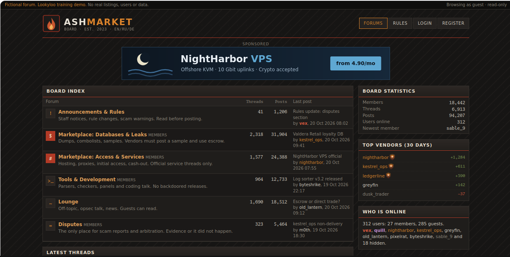
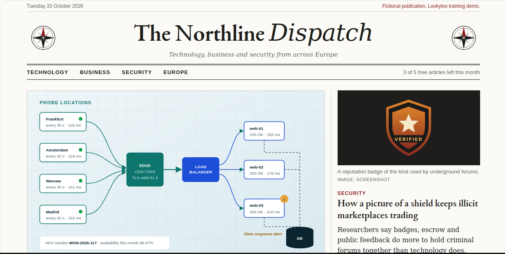
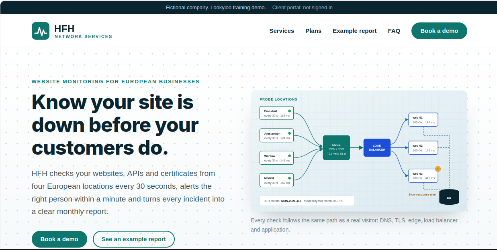

# Lookyloo demo sites

Four fictional websites for demonstrating website analysis with [Lookyloo](https://github.com/Lookyloo/lookyloo/). They look unrelated: an underground forum, a website-monitoring company and two news sites. They deliberately serve some byte-identical files, so captures can be linked through matching resource hashes.

All names, people, companies, listings and data are invented. Each site shows a visible demo notice. No form sends or stores anything.

## Sites

| Site | Document root | Public URL | Entry pages |
| --- | --- | --- | --- |
| Ashmarket (forum) | `sites/market/` | `https://market.internetpolice.com/` | `/`, `/thread.html`, `/login.html`, `/rules.html` |
| HFH Network Services (website monitoring) | `sites/hfh/` | `https://hfh.internetpolice.com/` | `/`, `/report.html`, `/services` (redirect) |
| The Northline Dispatch (news) | `sites/newscorp/` | `https://newscorp.internetpolice.com/` | `/`, `/outage-monitoring.html`, `/forum-reputation.html` |
| PrimeNews (news) | `sites/primenews/` | `https://primenews.internetpolice.com/` | `/`, `/web-shops-monitoring.html`, `/forum-badges.html` |

All site paths are relative.

## Running the server

One script serves all the sites and picks the document root from the `Host` header.

```bash
python3 server.py
```

Settings are at the top of `server.py` and can be overridden with environment variables:

| Variable | Default | Purpose |
| --- | --- | --- |
| `DEMO_BASE_DOMAIN` | `internetpolice.com` | Sites answer on `market.`, `hfh.`, `newscorp.` and `primenews.` under this domain. This is the only place the domain is configured. |
| `DEMO_BIND` | `127.0.0.1` | Listen address. Keep the default behind a reverse proxy. |
| `DEMO_PORT` | `8000` | Listen port. |

Requests for any other hostname get a `404`. Directory listings are disabled.

## Deployment

1. Create DNS records for `market`, `hfh`, `newscorp` and `primenews` under the chosen domain, pointing at the server or add the entries to the hosts file (of the Lookyloo host and your workstation)
2. Run `python3 server.py`. If you bind to port 80 then you will have to use sudo.

## Headers, cookies and the JSON request

`server.py` adds an `X-Demo-Site` header to every response and sets a cookie on the homepage (`/` and `/index.html`) only.

| Site | `X-Demo-Site` | Cookie |
| --- | --- | --- |
| Market | `market` | `ash_guest=guest-4471` |
| HFH | `hfh` | `hfh_visitor=v-20261020-0815` |
| NewsCorp | `newscorp` | `nld_reader=reader-0042` |
| PrimeNews | `primenews` | `pn_visitor=pv-7731` |

The cookies use `Path=/; HttpOnly; SameSite=Lax` without a `Domain`, so each one stays on its own subdomain. They have no `Secure` flag, so they also work over plain HTTP.

After the page loads, `ui-helper.js` fetches `/api/session.json` and shows its message in the header. PrimeNews does not load `ui-helper.js`, because its hash would link PrimeNews to Market and HFH. There, jQuery's request for `api/most-read.json` is the later request that sends the cookie back. If the capture starts at `/`, that request and the later asset requests carry the cookie. A capture that starts on a subpage has no cookie.

## Shared resources

Each site serves its own copy of these files. The only request from one demo subdomain to another is the PrimeNews profiler, described under the disinformation pair.

| Resource | Served by | SHA-256 |
| --- | --- | --- |
| `/assets/css/common.css` | Market, HFH, NewsCorp | `b68b98c01bfd32fe0040e7cf839573955bb2113933a32ae437ffff8e620a8925` |
| `/assets/js/ui-helper.js` | Market, HFH, NewsCorp | `34bd9ef2b5642a48b9b833c6d314e2677420f31115282215a2183ec82321125f` |
| `/assets/img/badge-verified.svg` | Market, NewsCorp | `e6e170496721d014cf2a8b3ac65fd33f0c07d72847fbb5ab1c687e74f36254f5` |
| `/assets/img/network-topology.svg` (HFH), `/assets/img/stories/europe-outage-monitoring.svg` (NewsCorp) | HFH, NewsCorp | `a1a3858d0367f593a32b2f3bf660f6ccf1e742811ea22752f57bde40af454619` |
| `/assets/img/stories/cloud-contracts.svg` (NewsCorp), `/assets/media/cloud-suppliers.svg` (PrimeNews) | NewsCorp, PrimeNews | `6452570bdef7bfb4d31d7cc930a01100782846b7df4a6f71c95793e891da485b` |
| `/assets/img/stories/council-chamber.svg` (NewsCorp), `/assets/media/ministers-meeting.svg` (PrimeNews) | NewsCorp, PrimeNews | `213b58195e7b13d0017dfdb45507a3979bae67ca0bb04d96447b571208f5424a` |
| `/assets/js/profile-loader.js` | NewsCorp, PrimeNews | `4d613310e2b4d5a126f4cc640d96b3a9276277f17d4c18d82060365672942f21` |
| Bootstrap 4.2.1 grid from an external site (see below) | NewsCorp, PrimeNews | `e6d573b7daafdee530dc4204ffb40f9bd192b3f65ed11a0bf02b18b909bca8a8` |

### Fonts and background images

Each site stylesheet loads its own font and background image. The stylesheet is the `Referer`, so Lookyloo shows these requests one level below the page resources. They differ per site and do not link the sites.

| Site | Stylesheet | Font | Background image |
| --- | --- | --- | --- |
| Market | `market.css` | `Go-Mono.ttf` | `bg-mesh.svg` |
| HFH | `hfh.css` | `Inter-ExtraBold.otf` | `hero-dots.svg` |
| NewsCorp | `newscorp.css` | `EBGaramond12-Bold.ttf` | `compass-rose.svg` (hidden on narrow screens) |
| PrimeNews | `primenews.css` | `PTSansNarrow-Bold.ttf` | None |

The fonts are unmodified copies of openly licensed fonts, with each licence file next to its font.

## External resource on NewsCorp

NewsCorp loads the Bootstrap 4.2.1 grid (MIT) directly from an external site and uses it for its page layout. The URL is in the `link` tag of each NewsCorp page. PrimeNews loads the same file. The other third-party requests are the PrimeNews libraries, the Market IP lookup and the end of the HFH redirect chain, all described below. On 20 October 2026 it returned `200`, `text/css` and 48,488 bytes with the hash above.

If you capture both NewsCorp and the site that hosts the file, the same URL and hash appear in both trees. That only shows NewsCorp links to a public file on that site. **It does not mean the owner of that site operates or endorses any demo site.** It is a useful counter-example: a matching resource often just comes from a common library.

If the file changes or disappears, the NewsCorp layout breaks and the hash no longer matches. Check it before presenting:

```bash
url=$(grep -o 'https://[^"]*bootstrap-grid.min.css' sites/newscorp/index.html)
curl -s "$url" | sha256sum
```

## Disinformation pair: NewsCorp and PrimeNews

PrimeNews is a tabloid-style site that republishes the NewsCorp articles under its own design. Use the pair to show how an investigation into coordinated inauthentic content can start: two sites that look different carry the same stories, so what else do they have in common?

Capture `https://newscorp.internetpolice.com/` and `https://primenews.internetpolice.com/`. To compare a single story, also capture `/forum-reputation.html` on NewsCorp and `/forum-badges.html` on PrimeNews.

| Clue | NewsCorp | PrimeNews | What it means |
| --- | --- | --- | --- |
| Article text | Original, with named reporters | The same headlines and article bodies word for word, credited to "PrimeNews staff" | Copied content. The copied outage article still says Clara Ostendorf writes "for this newspaper". |
| Article images | `assets/img/stories/cloud-contracts.svg`, `council-chamber.svg` | `assets/media/cloud-suppliers.svg`, `ministers-meeting.svg` | The same hashes under different names and paths. A strong lead that one site copied from the other. |
| Bootstrap grid | Same external URL | Same external URL | A shared third-party file. Weak evidence. |
| `profile-loader.js` | Own copy | Own copy, same hash | The same helper script on both sites. |
| `profiler.js` and its beacon | Loaded from its own host | Loaded from the NewsCorp host | A direct request from PrimeNews to NewsCorp, with the same tracking account `NLD-20431`. The strongest link between the two. |
| jQuery 3.7.1 and Bootstrap 5.3.3 JavaScript | Not loaded | From cdnjs and jsDelivr | Common public libraries. They show what PrimeNews depends on, not who runs it. |
| Design, font and favicon | Serif broadsheet, EB Garamond | Red and yellow tabloid, PT Sans Narrow | The look gives no hint of a link. |

PrimeNews leaves out NewsCorp's `europe-outage-monitoring.svg` and `badge-verified.svg` on purpose, because those files also link NewsCorp to HFH and Market. It does not load `common.css` or `ui-helper.js`, so it only connects to NewsCorp. Its `pn_visitor` cookie is host-only, so the requests to NewsCorp do not carry it.

On every page of both sites, `assets/js/profile-loader.js` adds a script tag for `assets/js/profiler.js` on the NewsCorp host. It derives that host from the current one, so it works locally and on the deployment domain. `profiler.js` then requests `/api/pixel.gif?account=NLD-20431&page=<path>` from NewsCorp, a 1×1 GIF. In a PrimeNews capture, expect `newscorp.internetpolice.com` in the tree with the script and the GIF beneath the page. A shared tracking account is a common sign of coordination, but anyone can copy a tracking snippet, so it is still a lead to verify.

After the page loads, `assets/js/primenews.js` uses jQuery to fetch `api/most-read.json` and fill the Most read list, so the tree shows a local JSON request made after the CDN scripts. On narrow screens the Sections menu uses Bootstrap's Collapse. It only opens on a click, but the script loads either way.

Expected, not yet checked in a capture: the hashes of both image pairs and of the grid stylesheet match across the two captures. Matching text and files are reasons to look further. They do not show who operates either site.

The CDN files are pinned versions. On 10 November 2026 they returned these hashes:

| File | SHA-256 |
| --- | --- |
| `jquery.min.js` 3.7.1 | `fc9a93dd241f6b045cbff0481cf4e1901becd0e12fb45166a8f17f95823f0b1a` |
| `bootstrap.bundle.min.js` 5.3.3 | `0833b2e9c3a26c258476c46266e6877fc75218625162e0460be9a3a098a61c6c` |

## IP lookup on Market

The Market homepage has a "Your connection" box in the sidebar. `assets/js/connection-check.js`, which only Market uses, fetches `https://ipinfo.io/json` after the page loads and shows the IP address, network and country it returns. The language, screen size, time zone and user agent come from the browser itself and need no request.

In a capture, expect a `GET` to `ipinfo.io` under the Market page that returns JSON. The screenshot shows the public address of the capture browser, or of the proxy if the capture uses one, so capturing with and without a proxy gives two different results. If the lookup fails, the box says "lookup failed" and the rest of the page is unaffected.

`ipinfo.io` is a live service used without an API key, which is rate-limited. The capture browser needs internet access.

## Language block on Market

`server.py` refuses Market requests whose preferred language, the first entry in `Accept-Language`, is `be`, `be-BY` or `ru-BY`. It answers the requested URL itself with `403 Forbidden` and the block page from `blocked.html`, and sets no cookie. Every other language gets the normal forum, including `ru-RU` and a list that only mentions `be` further down. Use it to show that what a site serves can depend on the capture settings.

The block page has inline styles and an empty favicon, so the refusal is the only request in the capture.

Capture `http://market.internetpolice.com/` twice: once with the default settings, and once with the browser language set to `be-BY`, through the capture's locale or an `Accept-Language: be-BY` header, depending on what your Lookyloo instance offers. Expected, not yet checked in a capture: the second capture contains only the `http` to `https` redirect and a `403` for `/`, with a screenshot of the block page.

A time zone cannot be used for this. The browser does not send it, so only a script on the page can read it, and by then Chrome has already requested the page's styles, images and scripts. That left aborted requests in the tree and confused Lookyloo about which page was rendered.

## Redirect chain on HFH

Capture `http://hfh.internetpolice.com/services` on its own to show how Lookyloo follows redirects. `server.py` answers both hops with a real `302`, so there are no `services.html` or `external.html` files.

| Request | Response |
| --- | --- |
| `/services` | `302`, `Location: /external` |
| `/external` | `302`, `Location: https://www.cudeso.be/` |

Expected in Lookyloo, not yet checked in a capture: the tree starts on `hfh.internetpolice.com` and continues on `www.cudeso.be`, with all three URLs listed as the redirect chain. The two HFH responses carry `X-Demo-Site: hfh` and no cookie.

`www.cudeso.be` is a live site, so the capture browser needs internet access, and the resources it loads can change between captures.

## Presenting with Lookyloo

Capture these in order and let indexing finish before looking for correlations:

1. `https://market.internetpolice.com/`
2. `https://hfh.internetpolice.com/`
3. `https://newscorp.internetpolice.com/`
4. The site that hosts the Bootstrap file

### Expected findings

These are what the sites are built to show. They have not been checked against a Lookyloo instance yet.

| Where to look | What you should see | What it means |
| --- | --- | --- |
| Screenshots | Three pages that look nothing alike. | Appearance gives no hint of a link. |
| Capture tree | One host per demo site, plus `ipinfo.io` on Market and the Bootstrap host on NewsCorp. | No request connects Market, HFH and NewsCorp to each other. |
| `common.css`, `ui-helper.js` | The same hash in all three captures. | The sites share code. A lead, not proof. |
| `badge-verified.svg` | The same hash on Market and NewsCorp. | An image copied between sites. |
| `europe-outage-monitoring.svg` | The same hash as HFH's `network-topology.svg`. | Content matches despite a different name and path. |
| `bootstrap-grid.min.css` | The same URL and hash on NewsCorp and the site that hosts it. | A shared third-party file. Weak evidence. |
| `ipinfo.io` on Market | A cross-origin request that returns JSON. | The page tells a third party who visited. |
| URL node for `/` | `Set-Cookie` and `X-Demo-Site`. | A server-set, host-only cookie. |
| `/api/session.json` | The request sends the homepage cookie. | The cookie is used on a later request. |

## Lookyloo API with pylookyloo

`pylookyloo_demo.py` shows the same findings through the [pylookyloo API](https://pylookyloo.readthedocs.io/en/stable/api_reference.html). Set it up once in a virtual environment:

```bash
python3 -m venv .venv
.venv/bin/pip install pylookyloo==1.43.1
```

The script talks to `https://lookyloo.demo.cudeso.be` unless `LOOKYLOO_URL` is set. That instance has a self-signed certificate, so add `-k`. Wherever a command takes a UUID, the capture's tree link works too.

| Command | API calls | What it shows |
| --- | --- | --- |
| `capture URL [--locale be-BY] [--timezone Europe/Minsk]` | `submit`, `get_status`, then the `report` calls | Submits a listed capture, waits up to two minutes and prints the tree link and report. |
| `report UUID` | `get_info`, `get_capture_stats`, `get_redirects`, `get_hostnames`, `get_cookies` | Title, redirect chain, hostnames and cookies of a capture. |
| `related UUID` | `get_hashes`, `get_hash_occurrences` | Response bodies that other captures received too, named after the matching file in `sites/` where there is one. |
| `compare LEFT RIGHT` | `compare_captures` | Lookyloo's comparison of two captures, including the URLs both loaded. |

For example:

```bash
.venv/bin/python pylookyloo_demo.py -k capture http://market.internetpolice.com/ --locale be-BY
.venv/bin/python pylookyloo_demo.py -k related <PrimeNews capture UUID>
.venv/bin/python pylookyloo_demo.py -k compare <NewsCorp capture UUID> <PrimeNews capture UUID>
```

`compare` and `related` answer different questions. `compare` matches URLs, so for NewsCorp and PrimeNews it finds the profiler, the beacon and the grid stylesheet. `related` matches content, so it also finds the two article images and `profile-loader.js`, which have the same bytes under different URLs.

Checked against the demo instance on 10 November 2026. Its URL and hostname occurrence endpoints returned `Internal Server Error` for most lookups, so the script does not use them. The API also does not say which URL a body hash belongs to, which is why `related` hashes the local files to name them.

## Screenshots





